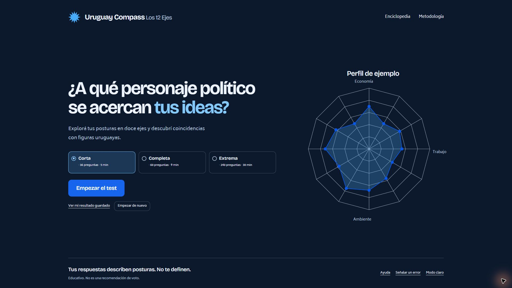

# Uruguay Compass

**Explore your political views across 12 dimensions and compare your answers with Uruguayan political figures and parties.** Take the questionnaire, find your closest matches, and understand where your views align or differ. A built-in encyclopedia explains the issues, people, and history behind the results.

**[Take the test at uruguaycompass.cc](https://uruguaycompass.cc/)** · Spanish (Uruguay) · Desktop and mobile



## Take the test

Choose a version and respond to statements about political debates in Uruguay:

- **Short:** 36 questions, about 5 minutes.
- **Full:** 60 questions, about 9 minutes.
- **Extreme:** 240 questions, about 30 minutes.

Each statement has five responses, from strongly disagree to strongly agree, including a neutral option. Go back to review an answer or leave and resume later in the same browser. No account is required.

Your results show separate scores for economy, taxation, labor, security, institutions, social values, religion, trade, foreign policy, immigration, education and services, and the environment. Each scale shows both ends and names the predominant pole beside its percentage, or shows a balanced position near the center. The result opens with a named ideological model, an editorial first-person phrase, and its percentage; details explain the four-axis model and ties. A score of 0 or 100 refers to that specific axis, not to a universal left–right label.

## Understand your results

- **Closest political matches:** compare your answers with 53 people on all twelve axes. The model combines 448 editorial placements with topical sources and 188 explicitly labeled, very uncertain AI-assisted hypotheses. Every profile shows its dates and reasoning. Ranking uses unrounded distance and preserves exact ties; the highlighted person and export card follow that result automatically.
- **Political spectrum:** locate all 53 people on an economy and security projection. Search, filter and select grouped coordinates without moving source points. Hypothetical coordinates are identified as very uncertain; this map does not summarize all twelve axes.
- **Your twelve axes:** see your positions with labeled percentages, colored bars, and pole icons. Explanations remain available in the encyclopedia.
- **Interpretations:** see the closest of five educational models, compare distinctive positions with documented reference medians, and inspect similarities and differences. The political compass appears near the end of the results; the earlier explanatory scale and separate model list have been removed.
- **Countries on the result card:** three constitutional matches based on dated documents. See [country sources and rubric](docs/PAISES.md).
- **Parties:** the result shows the three closest and two most distant program references with locally stored identifying images and their credits. The full comparison page retains all six parties.
- **Themes:** the sun/moon control switches between a light palette and a layered charcoal dark palette, with a short click-triggered transition that respects reduced motion.
- **Shareable result:** generate a dark PNG card with your closest figure, other references, countries, and twelve positions. Saving or sharing requires an explicit action.

These are educational editorial comparisons, not a scientifically validated assessment or voting recommendation. Every person and party is compared over the same twelve axes with equal weight: 100 minus their mean absolute distance from your scores. Placements may combine different periods. A hypothesis derived from a person’s documented thought is not an expressed opinion, and its contextual references do not count as topical evidence. Hypotheses can change the ranking; filling gaps does not demonstrate greater empirical precision. The original source layer retains unknown values. No answers are sent to an AI: the editorial research is independent of questionnaire responses. Questions, response scoring, saved answers, the four-axis ideology models, and three-axis country comparisons are unchanged.

## Explore the encyclopedia

Browse the twelve axes, profiles of **53 political figures** and **six parties**, a glossary and political history. All figures can appear as results. Their fiches distinguish topical sources from very uncertain hypotheses. The [original 22-person documentary report](docs/REFERENTES-22.md) is retained as a source-stage archive; the [twelve-axis research report](docs/AUDITORIA-12-EJES.md) describes the current interpretation layer.

The methodology and FAQ explain how scores and comparisons work. Found an error or disagree with a placement? Use the correction form to prepare a report, or [open a GitHub issue](https://github.com/faacuaramburu/UruguayCompass/issues) with supporting sources. Reports are never submitted automatically.

The [twelve-axis research report](docs/AUDITORIA-12-EJES.md) records the complete matrix, source passages, per-axis periods, confidence and all individual hypotheses. Run `npm run research:report` to regenerate it. The six parties also have twelve coordinates, including eight explicitly identified hypotheses.

## Your answers stay in your browser

Answers, progress, and results are processed and stored locally. They are not sent to a server, analytics, correction reports, or share links. You can repeat the test or delete your saved data from the app. Clearing browser storage also removes your progress; there is no account sync between devices.

Browser storage is tied to the site's address. Progress saved on [the Pages address](https://uruguaycompass.pages.dev/) or [the previous Render site](https://uruguaycompass.onrender.com/) stays at that address in the same browser.

The live site uses Cloudflare Web Analytics for traffic and performance statistics. Automatic SPA navigation tracking is disabled, and the app does not send questionnaire answers, scores, political affinities, or test interaction events to analytics. Result images are generated on your device.

## Built with

- **Languages:** JavaScript ES modules, HTML, and CSS.
- **Frontend:** static pages with hash-based routing, data-driven SVG charts, and Canvas for the home illustration and PNG export. No runtime framework or build step.
- **Storage:** browser local storage, with handling for unavailable storage.
- **Testing:** Node.js test runner and jsdom for scoring, data integrity, and application flows.
- **Hosting:** Cloudflare Pages, serving `dist/` from `main`.
- **Analytics:** Cloudflare Web Analytics.

## Run locally

Requires **Node.js 20.19 or newer** and npm.

```sh
git clone https://github.com/faacuaramburu/UruguayCompass.git
cd UruguayCompass
npm start
```

Open **[http://127.0.0.1:4173](http://127.0.0.1:4173)**. Stop the server with `Ctrl+C`. Serving the app does not require installing dependencies. Use HTTP rather than opening `index.html` directly.

Install development dependencies and run the checks:

```sh
npm ci
npm test
npm run check
```

The tests cover scoring extremes, neutral answers, shared comparison coverage, invalid saved data, complete questionnaire flows, chart geometry, filters, and keyboard selection.

## Deploy

The `uruguaycompass` project deploys automatically on pushes to `main` through [Cloudflare Pages' GitHub integration](https://developers.cloudflare.com/pages/configuration/git-integration/github-integration/). Use these project settings:

- **Framework preset:** None
- **Production branch:** `main`, with automatic deployments enabled
- **Build environment:** Pages build system v3 (Node.js 22)
- **Build command:** `npm ci --include=dev && npm test && npm run check`
- **Build output directory:** `dist`

The build command verifies the app. The static files in `dist/` are maintained directly in the repository. The manual Cloudflare Web Analytics beacon in `dist/index.html` uses a public site identifier and `spa: false`. Keep automatic Pages injection disabled so each page loads one beacon.

## Credits and documentation

- Typography: Sora for headings and Poppins for body text, using the same Latin Fontsource 5.3.0 faces as [12Axes](https://12axes.vercel.app/#guia-eixos). The fonts are served locally under the SIL Open Font License ([Sora](dist/fonts/Sora-OFL.txt), [Poppins](dist/fonts/Poppins-OFL.txt)).
- Political portraits: locally served documentary photographs with individual author and source credits; license information is recorded where provided. See [photo credits](docs/FOTOS.md).
- Editorial criteria: [result interpretations](docs/LECTURAS.md) and [political spectrum](docs/ESPECTRO.md).

The standalone **Comparador** follows the supplied 12Axes reference: search and compare up to three of the 53 people and six parties, with removable portrait cards, shared axis tracks, pairwise differences, a multi-profile compass, and shareable selection links. Existing positions and missing data remain unchanged; only documented numerical coordinates appear on charts. The comparator uses the same light and dark palettes and typography as the rest of the site. The encyclopedia presents twelve explanatory cards; test scoring is unchanged. Dark mode now uses layered charcoal surfaces. Photo and party-image credits reuse the local catalogs; three photographs without an identified open license use a default icon in the directory/comparator. See [country review and limitations](docs/PAISES.md) for the 12Axes comparison and period corrections.
